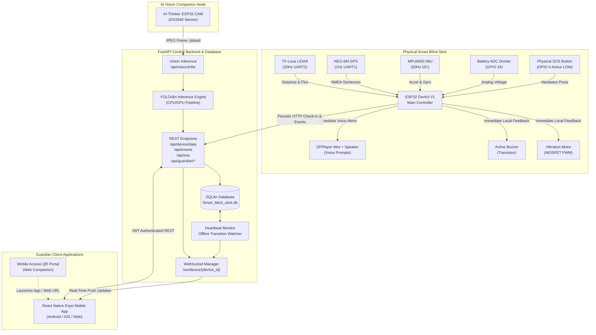

# DrishtiGuard System Architecture & End-to-End Data Flow

---

## 1. Architectural Layers & Responsibilities

### 1.1 Local Autonomous Safety Layer (Hard Real-Time)
- **Zero Cloud Dependency for Immediate Safety**: The user walking with the stick must never be endangered by Wi-Fi disconnection or cloud network latency.
- If an obstacle appears within 50cm, the TF-Luna driver on the ESP32 activates the vibration motor and active buzzer within **< 50 milliseconds**.
- If a candidate fall is confirmed by the MPU6050 pipeline, immediate local vocal guidance ("Fall detected") and haptic pulses trigger instantaneously.

### 1.2 Telemetry & Dispatch Layer (Soft Real-Time)
- The ESP32 collects valid sensor telemetry, validates ranges, rejects stale readings, and posts JSON payloads to `/api/device/data` every 3000ms.
- An **offline bounded event queue** buffers up to 10 critical alerts (SOS and confirmed falls) if Wi-Fi is temporarily lost, flushing them automatically upon reconnection.

### 1.3 Vision Companion Node
- The ESP32-CAM runs as an independent companion node on the stick body.
- It captures JPEG frames and POSTs them to `/api/vision/infer`.
- The FastAPI server runs YOLOv8n, tracks approaching objects across consecutive frames, and generates high-risk warnings if vehicles are approaching.

### 1.4 Guardian App & Real-Time Sync Layer
- The React Native Expo mobile application connects to the backend via JWT-authenticated REST APIs and a persistent WebSocket stream.
- The backend relays genuine sensor events to paired guardians in real-time.

---

## 2. Zero-Demo-Data Principles Across the System

| System State | Legacy Prototype Behavior | DrishtiGuard Real-Hardware Behavior |
| :--- | :--- | :--- |
| **No stick paired to guardian** | Displayed fake stick with canned 90% battery | Renders genuine empty state: `"No device paired yet"` |
| **Device powered off / offline**| Statically showed "Online" if backend was running| Checks `last_seen` timestamp. If > 30s: shows `"⚪ OFFLINE"` with last known info |
| **GPS receiver has no satellite fix**| Published fake coordinates `(15.85, 74.50)` | Reports `gps_available = false`, map shows `"No data available"` or `"GPS fix unavailable"` |
| **Battery ADC sensing unpopulated** | Fabricated random fluctuating percentage | Reports `battery = null`, battery card shows `"No data available"` |
| **No incident events in database** | Displayed fabricated fake alerts list | Renders `"No events recorded"` |
| **Camera disconnected or weights missing** | Fabricated synthetic object detections | Returns `"vision_unavailable"`, displays `"Vision unavailable"` |
