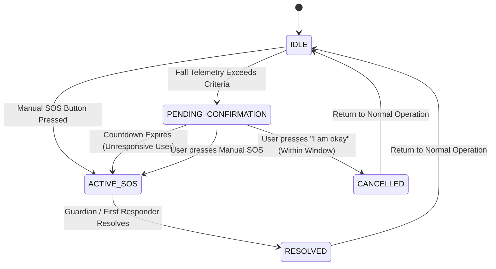

# Safety & Emergency Subsystem Documentation (Member 3)

**Project:** Smart Blind Stick Using IoT and Sensors  
**Module:** `feature/safety-emergency` (Safety Risk Assessment, Manual SOS, Automatic Fall Detection, Emergency State Machine, Guardian Alerting, Incident Audit Trail)  
**Author / Responsibility:** Member 3  

---

## 1. Executive Summary & Purpose

The **Safety & Emergency subsystem** is responsible for ensuring the physical safety of visually impaired users. It detects life-threatening emergency situations (sudden falls, collisions, manual distress calls) and autonomously coordinates real-time emergency responses, GPS localization, and multi-channel guardian notifications while minimizing false alarms through an interactive confirmation countdown window.

```
+------------------------------------------------------------------------------------+
|                               STATUS TAXONOMY                                      |
|                                                                                    |
|  [IMPLEMENTED SOFTWARE]         [SIMULATED]              [FUTURE HARDWARE]         |
|  • FastAPI REST Engine          • Multi-stage IMU Fall   • ESP32 / MPU6050 I2C     |
|  • Emergency State Machine        Telemetry Signals        Sensor Wiring           |
|  • Countdown Timer Logic        • NMEA GPS Coordinate    • Hardware SOS Pushbutton |
|  • Google Maps URL Generator      Drift & Synthesis      • Hardware Buzzer/Vibro   |
|  • Pluggable Notification Hub   • Guardian Console Alert   Haptic Motor            |
|  • SQLAlchemy ORM Audit Logs      & Push Dispatchers     • SIM800L GSM / Twilio    |
|  • Automated Pytest Suite       • Interactive CLI Demo     Production Gateway      |
+------------------------------------------------------------------------------------+
```

---

## 2. Architecture & State Machine

### 2.1 Emergency Lifecycle State Machine

The subsystem implements a finite state machine preventing duplicate or conflicting emergencies for the same stick:



### 2.2 Subsystem Dataflows

#### A. Manual SOS Workflow
```
[Physical / Mock SOS Button]
            │
            ▼
[POST /api/emergency/sos/manual]
            │
            ▼
[Emergency State Manager] ──> State = ACTIVE_SOS
            │
            ▼
[Location Service] ─────────> Capture Lat/Lon + Google Maps URL
            │
            ▼
[Notification Hub] ─────────> Dispatch Guardian Alert (Mock / SMS / Firebase)
            │
            ▼
[Audit Logging] ────────────> Immutable Record in emergency_logs & events tables
```

#### B. Automatic Fall Detection Workflow
```
[IMU Accelerometer / Gyroscope Stream]
            │
            ▼
[Fall Detection Service] (Free-fall + Impact Spike + Tilt Angle + Immobility)
            │
            ├── (Criteria Not Met) ──> Return Normal Activity (No Emergency Opened)
            │
            ▼ (Criteria Met)
[Emergency State Manager] ──> State = PENDING_CONFIRMATION (Countdown: 20s)
            │
      ┌─────┴────────────────────────────────┐
      │                                      │
      ▼ (User cancels before timeout)        ▼ (Timeout expires: 0s remaining)
[POST /api/emergency/sos/cancel]       [Auto-Escalation Engine]
      │                                      │
      ▼                                      ▼
State = CANCELLED                      State = ACTIVE_SOS
(Log reason, cancel alert)                   │
                                             ▼
                                       [Location Service] (GPS Map URL)
                                             │
                                             ▼
                                       [Notification Hub] (Urgent Alert)
                                             │
                                             ▼
                                       [Audit Logging] (Auto-SOS Audit)
```

---

## 3. Fall Detection Algorithm (Multi-Condition Pipeline)

Rather than relying on a naive single-axis acceleration threshold, the fall detection engine evaluates a 4-phase biomechanical profile:

$$\text{SVM} = \sqrt{a_x^2 + a_y^2 + a_z^2}$$

$$\theta_{\text{tilt}} = \arccos\left(\frac{a_z}{\text{SVM}}\right) \times \frac{180^\circ}{\pi}$$

1. **Free-Fall / Weightlessness Phase:** Acceleration drops below $0.6g$ during the descent.
2. **Impact Spike Phase:** Sudden deceleration spike exceeding $2.4g$ (configurable in settings).
3. **Tilt / Posture Change:** Inclination of the stick shifts beyond $40.0^\circ$ relative to the vertical axis.
4. **Post-Impact Immobility Phase:** Absence of motion for $\ge 2.5\text{ seconds}$ following the impact.

### Multi-Factor Confidence Metric:
$$\text{Confidence} = 0.40 \cdot \text{ImpactFactor} + 0.30 \cdot \text{TiltFactor} + 0.20 \cdot \text{Immobility} + 0.10 \cdot \text{FreeFall}$$

A fall is confirmed if $(\text{Impact} \land (\text{Tilt} \lor \text{Immobility}))$ or $\text{Confidence} \ge 0.65$.

---

## 4. REST API Specification

### Safety & Emergency Endpoints (`/api/emergency`)

| Method | Endpoint | Description |
| :--- | :--- | :--- |
| `POST` | `/api/emergency/sos/manual` | Triggers immediate `ACTIVE_SOS`, resolves GPS, and alerts guardian. |
| `POST` | `/api/emergency/fall/detect` | Ingests IMU telemetry; enters `PENDING_CONFIRMATION` countdown if fall confirmed. |
| `POST` | `/api/emergency/sos/cancel` | Cancels false-alarm fall or pending alert with audit reason. |
| `POST` | `/api/emergency/sos/resolve` | Marks active emergency as resolved after guardian assistance. |
| `GET` | `/api/emergency/status/{device_id}` | Returns live emergency state, countdown remaining, coordinates, and notification status. |
| `GET` | `/api/emergency/logs/{device_id}` | Retrieves chronological immutable audit logs and transitions. |

### Backward-Compatible Endpoint
| Method | Endpoint | Description |
| :--- | :--- | :--- |
| `POST` | `/api/sos` | Legacy universal SOS endpoint routing internally through the Emergency State Manager. |

---

## 5. Database Models

### `EmergencySession` (`emergency_sessions`)
- `session_id` (String, Unique Index) — e.g. `EMG-20260820-A1B2C3`
- `device_id` (String, FK `devices.device_id`)
- `state` (String) — `IDLE`, `FALL_DETECTED`, `PENDING_CONFIRMATION`, `ACTIVE_SOS`, `CANCELLED`, `RESOLVED`
- `trigger_type` (String) — `MANUAL_SOS`, `AUTOMATIC_FALL`
- `fall_confidence` (Float) — $0.0$ to $1.0$
- `countdown_seconds` (Integer) — e.g. $20$
- `latitude` / `longitude` (Float, Nullable)
- `maps_url` (String) — e.g. `https://maps.google.com/?q=12.971600,77.594600`
- `cancellation_reason` (String, Nullable)
- `resolution_notes` (String, Nullable)
- `notification_status` (String) — `NONE`, `PENDING`, `DISPATCHED`, `FAILED`, `CANCELLED`
- `notification_details` (JSON)
- `started_at`, `confirmed_at`, `cancelled_at`, `resolved_at` (UTC DateTime)

### `EmergencyLog` (`emergency_logs`)
- `id` (Integer, Primary Key)
- `session_id` (String, Index)
- `device_id` (String, Index)
- `previous_state` (String, Nullable)
- `new_state` (String)
- `event_type` (String) — e.g. `MANUAL_SOS_TRIGGERED`, `FALL_DETECTED_PENDING_CONFIRMATION`, `AUTO_SOS_ESCALATION`, `EMERGENCY_CANCELLED_BY_USER`, `EMERGENCY_RESOLVED`
- `message` (String)
- `extra_data` (JSON)
- `timestamp` (UTC DateTime)

---

## 6. Simulation & Testing Guide

### 6.1 Running the Interactive Emergency Simulator
To test and demonstrate all emergency workflows without physical hardware:

```bash
# Start backend server in Terminal 1
python run.py

# In Terminal 2, run automated end-to-end demo
python scripts/simulate_emergency.py --demo

# Or launch interactive menu
python scripts/simulate_emergency.py
```

### 6.2 Running Automated Pytest Suite
```bash
python -m pytest -v
```

All 17 tests validate:
1. Immediate Manual SOS activation and guardian alert generation.
2. Duplicate SOS prevention and session updating.
3. GPS coordinate attachment and Google Maps URL validation.
4. Graceful handling of missing/unavailable GPS hardware with simulated fallback.
5. Guardian notification dispatch and recipient verification.
6. Positive multi-condition fall detection (high impact + tilt + immobility).
7. Negative fall detection / false-alarm rejection (normal walking motions).
8. Confirmation window entry and countdown management.
9. False-alarm cancellation by user (`POST /api/emergency/sos/cancel`).
10. Automatic SOS escalation when confirmation countdown expires.
11. Emergency resolution workflow (`POST /api/emergency/sos/resolve`).
12. Device emergency status querying.
13. Immutable audit trail log retrieval.
14. Backward compatibility with legacy `POST /api/sos`.
15. Base device check-in and connectivity status.
16. Time-series location history tracking.
17. Multi-subsystem event ingestion and risk filtering.

---

## 7. Future Hardware Integration Plan

When physical hardware becomes available in subsequent project phases:

1. **ESP32 Microcontroller:**
   - Flash MicroPython / C++ Arduino firmware to poll the hardware SOS momentary pushbutton with software debouncing.
   - On button press, make HTTP `POST /api/emergency/sos/manual`.
2. **MPU6050 6-DOF IMU Sensor:**
   - Connect MPU6050 over I2C to ESP32 (GPIO 21 SDA, GPIO 22 SCL).
   - Compute real-time vector magnitude and orientation, sending telemetry to `POST /api/emergency/fall/detect`.
3. **NEO-6M GPS Module:**
   - Connect over UART to ESP32 hardware serial.
   - Parse NMEA `$GPGGA` sentences for real-world latitude/longitude before transmitting.
4. **Haptic & Audio Buzzer Feedback:**
   - When entering `PENDING_CONFIRMATION`, trigger pulsating buzzer and haptic vibration on the stick handle to notify the user of the countdown window.
5. **GSM SIM800L / Live Twilio SMS:**
   - Swap `NOTIFICATION_ADAPTER=sms` in `.env` and plug in Twilio API credentials or GSM AT commands for cellular SMS delivery.
